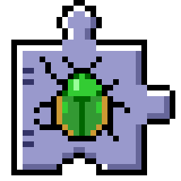

<p align="center"></p>

# Jitterbug

A system-wide cryptographic random source for Mac OS 9, targeting the Blue & White
Power Mac G3. Think `/dev/urandom` for classic Mac OS: an extension collects timing
noise from the whole system, and any app can ask it for random bytes.

**Status:** early. The portable engine and a host-side simulator work and are tested.
The first hardware tool (a sample collector app) and the system extension itself
build with Retro68, but neither has been run on a real Mac yet. Entropy credits
are unmeasured placeholders: do not rely on Jitterbug's output.

## Quick start

```sh
# 1. Host side: build the engine, simulator and tests
scripts/test-host.sh

# 2. Play with the simulated B&W noise sources
build-host/jb_sim list
build-host/jb_sim run -p cold-boot -t 60
build-host/jb_sim run -p degenerate -t 60     # must never seed
build-host/jb_sim run -p bw-g3-active -t 60 -n 10000000 -o out.bin   # for dieharder/PractRand

# 3. Mac side: get Retro68 (Docker image by default) and cross-compile
scripts/setup-retro68.sh
scripts/build-mac.sh ppc

# 3b. Boot-test the extension in QEMU (once: install OS 9 onto a Mac OS Standard disk)
scripts/build-mac.sh 68k
scripts/test-qemu-os9.sh install "MacOS 9.2.2.iso"
scripts/test-qemu-os9.sh run --stimulus    # types keys so it can seed headless

# 4. Run on the B&W (LaunchAPPLServer running there, TCP mode, trusted LAN only)
JB_MAC_IP=192.168.1.42 scripts/deploy.sh

# 5. Bring "Jitterbug Trace" back to the dev machine, then:
build-host/jb_sim replay -i "Jitterbug Trace"
scripts/assess.sh "Jitterbug Trace"
```

## How it fits together

```
 interrupt time                task time                         callers
 ┌──────────────┐  push  ┌──────────┐  ┌─────────┐  ┌──────┐  ┌──────────┐
 │ jGNEFilter,  │ ─────▶ │ SPSC ring│─▶│ SP800-90B│─▶│SHA-256│─▶│HMAC-DRBG │─▶ JBRandomBytes()
 │ Time Mgr, OT │        └──────────┘  │ health   │  │ pool  │  └──────────┘
 └──────────────┘                      └─────────┘  └──────┘
   (real Mac)          ▲ jb_sim feeds the same ring with modelled or replayed samples
```

## Using Jitterbug from your app

Copy `mac/sdk/Jitterbug.h` and `mac/sdk/JitterbugGlue.c` into your project.
They are C89, work on 68K and PowerPC, and need no link-time dependency: when the
extension is missing, every call returns `kJBErrNotPresent`. `JBRandomBytes` fails
closed. It returns `kJBErrNotReady` (and zeroes your buffer) until the extension is
seeded, so check its result every time.

`mac/demo/demo.c` builds **JitterbugDemo**, a small app you can copy from. Its
buttons flip a coin, roll a die (with unbiased rejection sampling), make a
128-bit key and make a password. A status line shows what `JBStatus` reports,
and the buttons stay dimmed until the extension is ready. All the Jitterbug
calls are in one section at the top of the file. Build it with
`scripts/build-mac.sh ppc` (or `68k`); the app is
`build-mac-<arch>/mac/JitterbugDemo.bin`.

The Finder icon is drawn as ASCII art in `mac/resources/icon/make_icons.py`, which
generates `mac/resources/JitterbugIcons.r` and the previews.

See `docs/ARCHITECTURE.md`, `docs/ENTROPY_POLICY.md`, `docs/SIMULATION.md`,
and `docs/PRIOR_ART.md`.

## License

MIT. See `LICENSE`.
